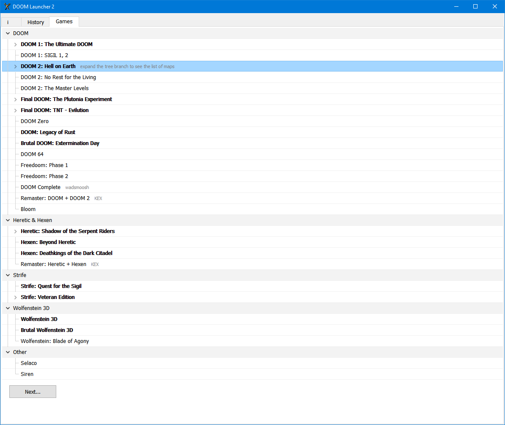
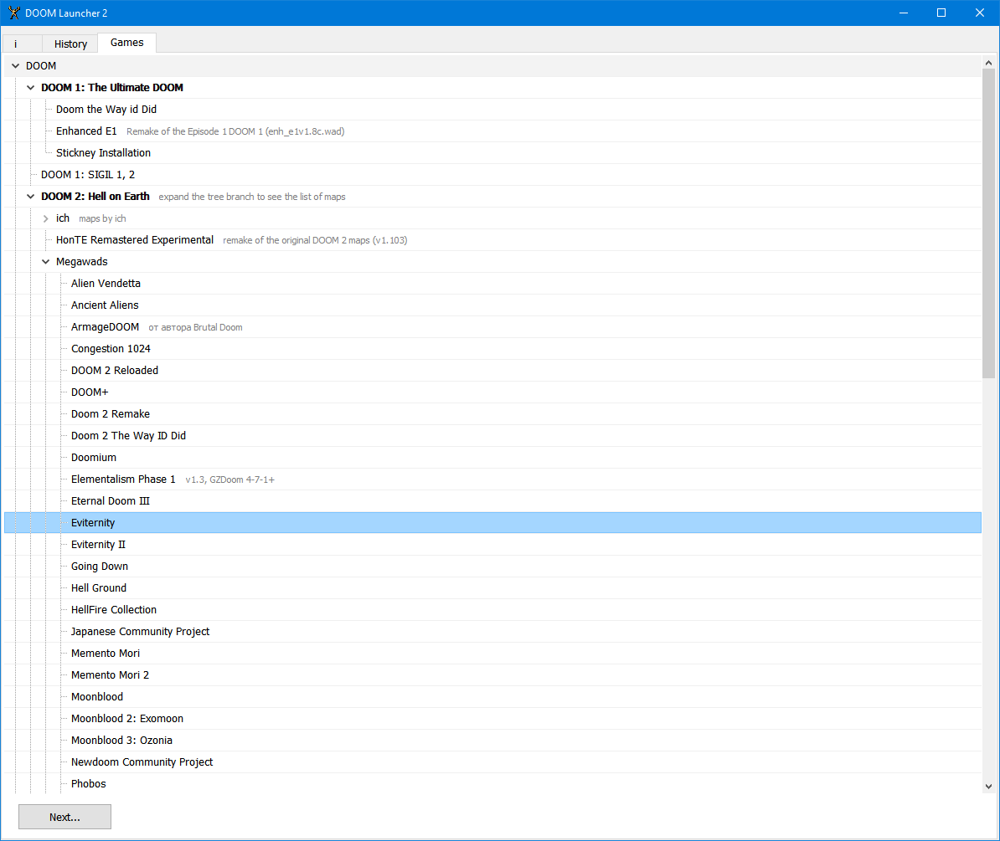
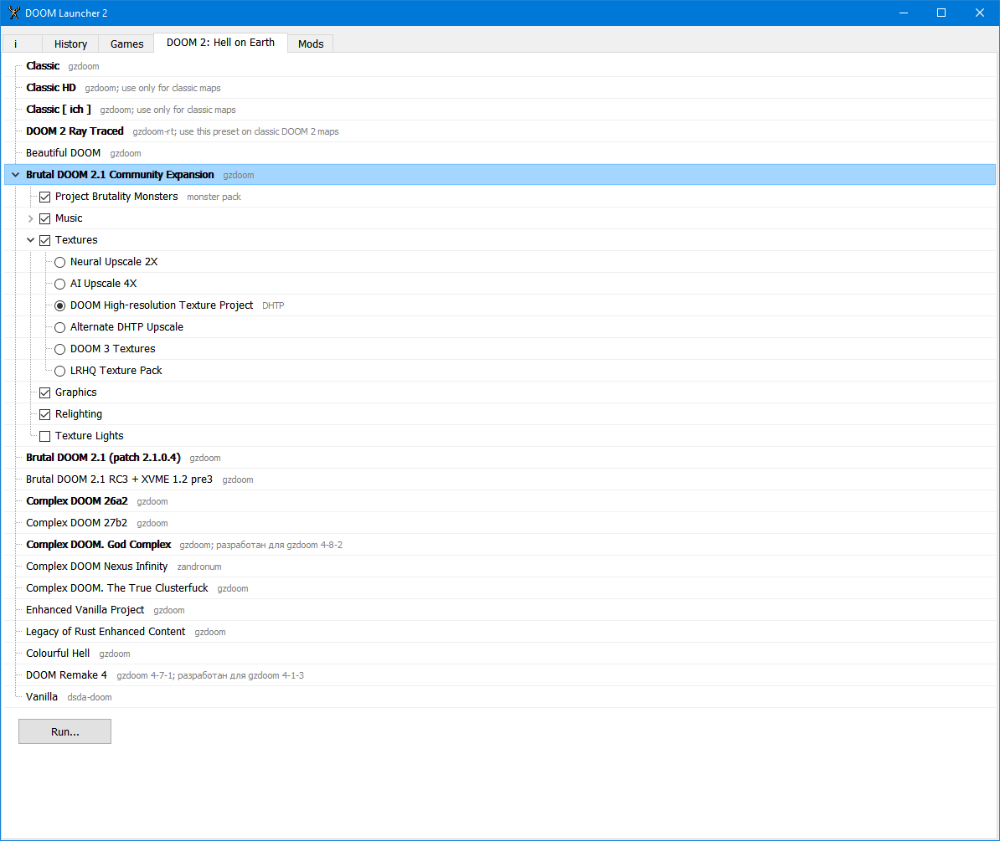
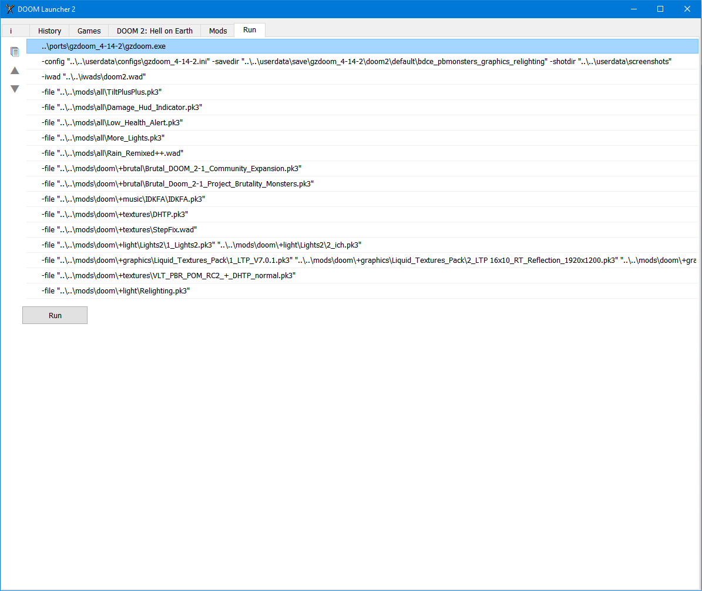
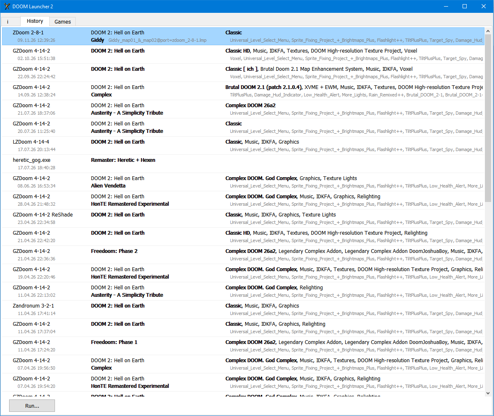

# DOOM Launcher 2

* **Год написания:** 2026
* **Среда разработки:** Delphi 12

Проект был создан как заменитель сотен батников, которые начали появляться в папке с играми семейства первых DOOM. Сначала были батники для различных игр, потом они начали обрастать батниками для своих и любимых карт, потом начали появляться HD-текстуры, 3D-объекты, музыка, сборки с просторов Интернета. DOOM, Heretic, HEXEN, Strife, Wolf 3D… И моды, моды, моды. Количество вариантов запуска превысило психические возможности плодить новые батники, которые уже давно сами вызывали универсальные батники для запуска, которые вызывали батники с настройками для запуска батников.

Сложность еще в том, что многие моды не совместимы с разными версиями движков. Многие моды не совместимы друг с другом. Не совместимы с различными картами. Да и вообще помнить, как, что и с чем запускать, и в каком порядке, стало просто не реально. Даже мне, с учетом того, что мне нравится очень небольшой диапазон геймплея. И я не играю во всё подряд.

Конечно, в Интернете есть десятки лаунчеров для DOOM. Они прекрасны, универсальны, с большим функционалом. Они удобны, когда ты сел, накидал нужных модов в список, выбрал карту, порт, и запустил. А потом хочется другой файл с уровнями. Потом хочется немножко поменять моды. Потом другие моды. А потом вот компьютер послабее, хочется вариант с модами полегче. А уровней десятки, сотни. И там опять хренова туча не пойми что в списках, которые названы на скорую руку. 

А потом через год, два, десять, двадцать (!), ни в жизнь не вспомнишь, как и что называется, какие моды надо запускать с какими версиями GZDOOM. А еще есть моды, в которых есть файлы только для DOOM1 и только для DOOM2. А вспомни через дцать лет! А еще внутри архивов-модов разная структура папок: старая и новая. И разные порты их по-разному воспринимают… 

Короче, заморочек столько, что было желание все это один раз настроить и положить в коллекцию, как замена батников. Чтобы запустил, сделал пару кликов и играешь во что хочешь. И чтобы можно было продолжить играть в то, что не закончил дцать лет назад, не вспоминая, где лежать файлы сохранения. Да-да, файлы сохранения теперь не в куче, а у каждого варианта запуска – свои.

Программа не шибко сложная. Самое долгое – это формирование структуры папок, отбор и экспериментальная проверка совместимости игр, уровней, модов, движков между собой. Настройка пресетов с постоянным и дополнительным наполнением.

Из любопытного, что есть в программе, - это ini-файлы с расширенным функционалом, которые могут приклеиваться к любому файлу или папке в структуре каталогов. Они подключаются сами при чтении папок программой. Содержат в себе дополнительную информацию о файле/папке: дополнительные или расширенные названия, комментарии, совместимость с играми, модами, портами, порядок сортировки и пр… 

Сами ini-файлы, кроме привычных секций с данными, могут иметь в начале себя список без секции, который используется… как список строк. Например, как список модов, или как список параметров запуска для порта игры.

Данные, содержащиеся в приклеивающихся ini-файлах, также можно прописывать в названия самого файла. 

Скачать можно в [разделе релизов](./../../releases).

Или на сайте [ich.su](https://ich.su/doomlauncher). 

Скриншоты:

* 
* 
* 
* 
* 
* 
  
#

страница проекта на гитхабе:
[github.com/ich-su/doomlauncher](https://github.com/ich-su/doomlauncher)

страница на ich.su:
[ich.su/doomlauncher](https://ich.su/doomlauncher)
